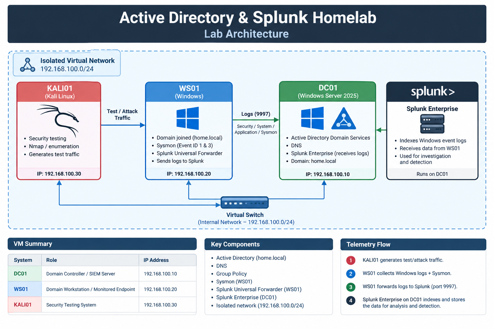
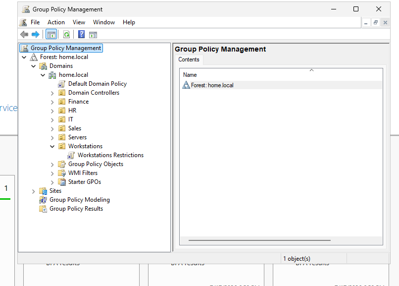
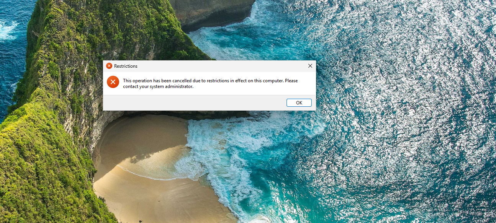

# Active Directory & Splunk SOC Homelab

## Overview

This project documents the development of my virtual cybersecurity homelab used to practice SOC monitoring, security investigation, and detection engineering.

The environment was built in Oracle VirtualBox and includes a Windows Server domain controller, a domain-joined Windows workstation, and a Kali Linux system used to generate controlled security activity. Splunk Enterprise provides centralized log collection and analysis, with Windows event logs and Sysmon telemetry forwarded from the workstation.

I use this environment to simulate security events, investigate endpoint and network telemetry, develop SPL detections, and validate alerting workflows.

## Lab Architecture

## Lab Environment

| System | Role | Configuration |
|---|---|---|
| **DC01** | Domain Controller / SIEM Server | Windows Server 2025, Active Directory Domain Services, DNS, Splunk Enterprise |
| **WS01** | Domain Workstation / Monitored Endpoint | Windows, Splunk Universal Forwarder, Sysmon |
| **KALI01** | Security Testing System | Kali Linux, Nmap and other security testing tools |

### Network

The lab operates on an isolated virtual network using the `192.168.100.0/24` private address space.

- **DC01:** `192.168.100.10`
- **WS01:** `192.168.100.20`
- **KALI01:** `192.168.100.30`
- **Domain:** `home.local`

 ## Security Monitoring

WS01 is configured as the primary monitored endpoint in the lab. Windows security telemetry and Sysmon events are collected from the workstation and forwarded to Splunk Enterprise running on DC01.

The Splunk Universal Forwarder on WS01 sends log data to DC01 over TCP port 9997.

### Monitored Data Sources

- Windows Security Event Log
- Windows System Event Log
- Windows Application Event Log
- Sysmon Operational Log
- Windows Firewall telemetry

This telemetry provides visibility into authentication activity, process creation, network connections, and other endpoint events used for security investigations and detection development.

## Active Directory & Group Policy

DC01 serves as the domain controller for the `home.local` Active Directory domain. The environment includes organizational units used to separate systems and users, including Workstations, Servers, IT, HR, Finance, and Sales.

WS01 is joined to the domain and placed within the Workstations organizational unit, allowing workstation-specific policies to be centrally managed through Group Policy.

### Workstation Restrictions

A Group Policy Object named `Workstations Restrictions` is linked to the Workstations OU. The policy restricts access to Control Panel and Windows PC settings for users affected by the policy.

The policy was validated from WS01 by attempting to access a restricted Windows setting. Windows blocked the action and displayed a restrictions message, confirming that the Group Policy configuration was successfully applied.
### Group Policy Configuration

### Policy Validation

## Security Testing & Attack Simulation

KALI01 serves as the security testing system within the lab and is used to generate controlled attack activity against the monitored Windows workstation.

Security testing is performed in the isolated lab environment to generate realistic telemetry that can be collected, investigated, and analyzed in Splunk.

Testing performed within the environment includes:

- Network reconnaissance and port scanning using Nmap
- Repeated failed authentication attempts to simulate brute-force activity
- Suspicious PowerShell execution using encoded commands

These simulations provide the telemetry used to practice the full detection workflow, from attack generation and log analysis to detection development and alert validation.

## Detection Engineering

Splunk Enterprise is used as the central platform for investigating security telemetry and developing detections based on activity generated within the lab.

Using Splunk Search Processing Language (SPL), I analyze Windows and Sysmon events, identify relevant fields and behavioral patterns, and develop detection logic designed to identify suspicious activity while reducing unnecessary results.

Detections developed and validated within the environment include:

- Network reconnaissance and port scan detection using Windows Filtering Platform Event ID 5152
- Failed login and brute-force detection using Windows Security Event ID 4625
- Suspicious encoded PowerShell detection using Sysmon Event ID 1

Each detection is tested using controlled activity, investigated in Splunk, refined using relevant event fields and thresholds, and configured as a scheduled alert for continued monitoring.

## Completed Security Projects

The following projects were developed within this homelab to practice security monitoring, investigation, detection engineering, and alert validation using realistic Windows and Sysmon telemetry.

### [Network Reconnaissance / Port Scan Detection](https://github.com/RyanRMorales/network-reconnaissance-port-scan-detection)

Simulated network reconnaissance from KALI01 using Nmap and investigated blocked network traffic from WS01 using Windows Filtering Platform Event ID 5152.

Developed an SPL detection that identifies sources targeting a high number of unique destination ports and configured a scheduled high-severity Splunk alert.

**Key Technologies:** Kali Linux, Nmap, Splunk, Windows Filtering Platform, SPL

### [Failed Login / Brute-Force Detection](https://github.com/RyanRMorales/failed-login-brute-force-detection)

Simulated repeated failed SMB authentication attempts from KALI01 against WS01 and investigated Windows Security Event ID 4625 authentication failures in Splunk.

Developed an SPL detection for repeated failed logins originating from the same source and account within a defined time window and configured a scheduled high-severity Splunk alert.

**Key Technologies:** Kali Linux, SMB, Splunk, Windows Security Logs, SPL

### [Suspicious PowerShell Activity Detection](https://github.com/RyanRMorales/suspicious-powershell-activity-detection)

Generated controlled encoded PowerShell activity on WS01 and investigated Sysmon Event ID 1 process creation telemetry in Splunk.

Developed an SPL detection for PowerShell executions containing encoded command parameters and configured a scheduled high-severity Splunk alert.

**Key Technologies:** PowerShell, Sysmon, Splunk, SPL

### [SOC Security Monitoring Dashboard](https://github.com/RyanRMorales/soc-SIEM-monitoring-dashboard)

Developed a centralized SOC monitoring dashboard in Splunk that combines suspicious authentication, network reconnaissance, and suspicious PowerShell activity into a single monitoring interface.

Created single-value panels for rapid detection visibility and detailed investigation tables that provide analysts with relevant event context for triage and further investigation.

**Key Technologies:** Splunk Enterprise, SPL, Windows Security Logs, Sysmon, Windows Filtering Platform

### [Wireshark Network Traffic Analysis](https://github.com/RyanRMorales/wireshark-network-traffic-analysis)

Captured and analyzed network traffic within the home lab using Wireshark. Investigated ICMP, TCP, and DNS activity, analyzed network conversations and TCP connection behavior, followed TCP streams to identify application traffic, and used packet-level evidence to distinguish unusual network activity from confirmed malicious behavior.

### [Vulnerability Assessment and Remediation](https://github.com/RyanRMorales/vulnerability-assessment-and-remediation)

Deployed Greenbone/OpenVAS using Docker Compose to conduct vulnerability assessments against an intentionally vulnerable Linux server. Analyzed and prioritized six security findings using CVSS severity ratings, exploitability, and potential impact.

Implemented firewall access restrictions, replaced default administrative credentials, and disabled vulnerable services to address five prioritized findings. Performed a post-remediation assessment and independent connectivity, authentication, and host-level validation to verify the implemented controls. Documented the remaining Ubuntu 8.04 end-of-life vulnerability as an unresolved Critical risk.

**Key Technologies:** Greenbone/OpenVAS, Docker, Linux, iptables, SSH, CVSS, Oracle VirtualBox

## Tools & Technologies

- **SIEM / Log Analysis:** Splunk Enterprise, Splunk Universal Forwarder, SPL
- **Endpoint Telemetry:** Sysmon, Windows Event Logs, Windows Defender Firewall
- **Operating Systems:** Windows Server 2025, Windows 10 Pro, Kali Linux, Ubuntu Linux
- **Identity & Administration:** Active Directory Domain Services, DNS, Group Policy
- **Security Testing:** Nmap, SMB, PowerShell, Netcat
- **Network Traffic Analysis:** Wireshark, TCP/IP, DNS, ICMP
- **Vulnerability Management:** Greenbone/OpenVAS, CVSS, Vulnerability Scanning and Validation
- **Linux Security & Administration:** iptables, SSH, Service Configuration, Process and Port Inspection
- **Containers & Virtualization:** Docker, Docker Compose, Oracle VirtualBox

## Skills Demonstrated

- SIEM monitoring and security event analysis using Splunk Enterprise
- SPL query development, security dashboards, and alert configuration
- Detection and investigation of suspicious PowerShell activity, failed authentication attempts, and network reconnaissance
- Windows Event Log analysis and endpoint monitoring using Sysmon
- Active Directory administration, user management, and Group Policy configuration
- Network traffic capture and protocol analysis using Wireshark
- TCP/IP troubleshooting and interpretation of DNS, ARP, ICMP, and TCP communications
- Vulnerability scanning and assessment using Greenbone/OpenVAS
- CVSS-based vulnerability risk assessment and remediation prioritization
- Linux system administration, service management, and firewall access control
- Security remediation through credential replacement, service deactivation, and network access restrictions
- Post-remediation validation using connectivity testing, authentication verification, and host-level inspection
- Vulnerability documentation, technical reporting, and residual risk assessment
- Virtual machine deployment, isolated network configuration, and Docker-based service deployment

## Future Development

This homelab will continue to evolve as I develop additional security monitoring, detection, and investigation capabilities.

Planned improvements include:

- Expanding detection coverage for additional Windows and network-based threats
- Developing more advanced attack simulations and multi-stage detection scenarios
- Expanding security telemetry and data sources available within Splunk
- Correlating network packet analysis with SIEM telemetry during security investigations
- Expanding the homelab with IT support and help desk workflows, including a self-hosted ticketing system
- Continuing to improve SOC investigation, alert triage, and incident analysis workflows

## Lab Scope

All security testing and attack simulations documented in this repository were performed within an isolated virtual lab environment for educational and cybersecurity training purposes.

